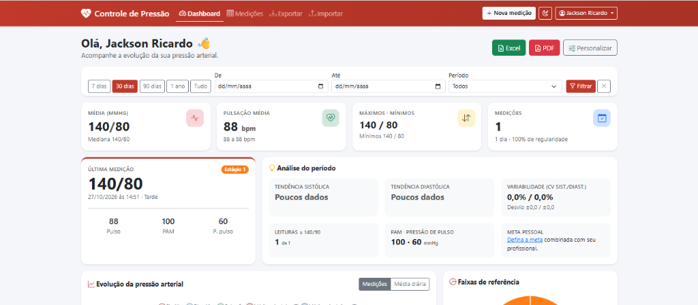
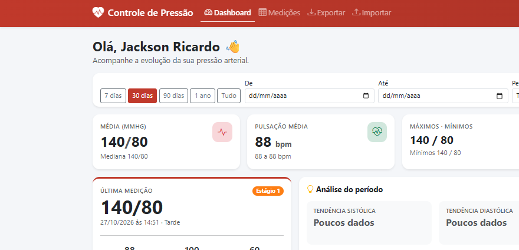
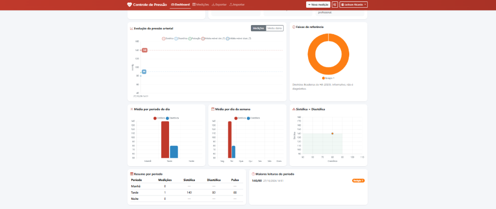
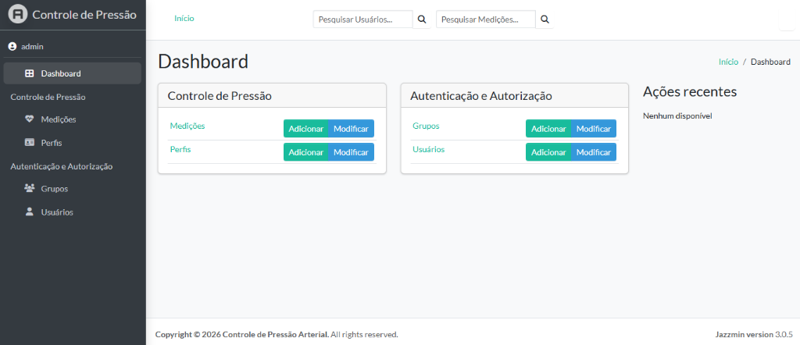

# Controle de Pressão Arterial

Sistema web desenvolvido em **Django** para registro, monitoramento contínuo, **análise estatística avançada** e geração de relatórios (Excel e PDF) de medições de pressão arterial e frequência cardíaca.

> **Aviso importante:** As classificações e indicadores exibidos pelo sistema baseiam-se nas *Diretrizes Brasileiras de Hipertensão Arterial (2020)* e têm caráter exclusivamente informativo e estatístico, **não substituindo avaliação ou diagnóstico médico**.

---

## Demonstração Visual do Sistema

### 1. Dashboard Principal e Indicadores em Tempo Real
Visão consolidada com filtros rápidos por período (`7 dias`, `30 dias`, `90 dias`, `1 ano`, `Tudo` ou intervalo personalizado), cartões de resumo estatístico, última medição classificada e atalhos para exportação imediata em **Excel** e **PDF**.





### 2. Painel Gráfico e Análise Multidimensional
Visualizações interativas para acompanhamento da evolução temporal, distribuição por faixas de referência, comportamento por turno do dia, variação por dia da semana e correlação Sistólica × Diastólica.



### 3. Relatório Analítico em PDF
O sistema gera laudos estatísticos prontos para impressão ou envio ao profissional de saúde, contendo tabelas de indicadores, gráficos de evolução, análise por período do dia, gráfico de pizza das faixas de referência e histórico completo de leituras.

- 📄 **[Visualizar Exemplo de Relatório em PDF (`docs/relatorio_exemplo.pdf`)](docs/relatorio_exemplo.pdf)**

### 4. Administração com Django Jazzmin
Painel administrativo moderno para gestão de usuários, grupos, perfis clínicos e medições registradas.



---

## Motor de Análise de Dados (`pressao/analytics.py`)

O grande diferencial do projeto é seu núcleo de **análise de dados e bioestatística aplicada**, implementado de forma leve utilizando a biblioteca padrão `statistics` do Python em conjunto com agregações do Django ORM. Todas as análises são recalculadas dinamicamente conforme os filtros aplicados no Dashboard e também compõem os relatórios exportados em `.xlsx` e `.pdf`.

### 1. Estatística Descritiva e Variabilidade Pressórica
Para cada série de dados (**Sistólica**, **Diastólica**, **Pulsação**, **PAM** e **Pressão de Pulso**), o sistema calcula:
- **Média aritmética** (`fmean`) e **Mediana** (`median`) — reduzindo o impacto de picos isolados na interpretação do período;
- **Valores Máximos e Mínimos** absolutos registrados no intervalo;
- **Desvio Padrão Amostral** (`stdev`) — mede a dispersão das leituras em torno da média;
- **Coeficiente de Variação ($\text{CV}\%$):**
  $$\text{CV}(\%) = \left(\frac{\text{Desvio Padrão}}{\text{Média}}\right) \times 100$$
  Essencial para avaliar a **estabilidade ou instabilidade pressórica** do paciente ao longo dos dias.

### 2. Indicadores Hemodinâmicos Derivados
Calculados automaticamente em cada registro (`pressao/models.py`):
- **Pressão Arterial Média ($\text{PAM}$):** estima a pressão de perfusão tecidual média durante o ciclo cardíaco:
  $$\text{PAM} = \frac{\text{PAS} + 2 \cdot \text{PAD}}{3}$$
- **Pressão de Pulso ($\text{PP}$):** diferença entre a pressão sistólica e a diastólica ($\text{PAS} - \text{PAD}$), indicador importante de rigidez arterial.

### 3. Análise de Séries Temporais, Tendência e Média Móvel
- **Regressão Linear Temporal (`linear_regression`):** a partir de 3 ou mais leituras em horários distintos, o sistema ajusta uma reta de mínimos quadrados sobre o tempo e calcula a **taxa de variação semanal (mmHg/semana)** para sistólica e diastólica, classificando automaticamente a tendência em:
  - **Em alta** ($> +0{,}5\text{ mmHg/semana}$)
  - **Em queda** ($< -0{,}5\text{ mmHg/semana}$)
  - **Estável** (entre $-0{,}5$ e $+0{,}5\text{ mmHg/semana}$)
- **Média Móvel de 7 Leituras:** suaviza flutuações momentâneas no gráfico de linha para destacar a tendência subjacente.
- **Médias Diárias Consolidada:** agrupa múltiplas aferições de um mesmo dia para evitar viés de dias com mais medições.
- **Comparativo 30 Dias Atuais vs. 30 Dias Anteriores:** calcula o delta ($\Delta\text{ mmHg}$) entre janelas móveis consecutivas de 30 dias.

### 4. Estratificação por Faixas de Referência e Detecção de Picos
Classificação automática segundo as **Diretrizes Brasileiras de Hipertensão Arterial (2020)** considerando sempre a faixa mais grave atingida entre PAS e PAD:

| Faixa de Referência | Sistólica (mmHg) | Diastólica (mmHg) |
| :--- | :---: | :---: |
| **Ótima** | $< 120$ | $< 80$ |
| **Normal** | $120 - 129$ | $80 - 84$ |
| **Pré-hipertensão** | $130 - 139$ | $85 - 89$ |
| **Hipertensão Estágio 1** | $140 - 159$ | $90 - 99$ |
| **Hipertensão Estágio 2** | $160 - 179$ | $100 - 109$ |
| **Hipertensão Estágio 3** | $\ge 180$ | $\ge 110$ |

- Contabiliza o **percentual de permanência** em cada faixa;
- Destaca a contagem de **leituras elevadas** ($\ge 140/90\text{ mmHg}$) e **muito altas** ($\ge 180/110\text{ mmHg}$);
- Lista o **Top 5 de maiores picos pressóricos** do período;
- Plota o **Gráfico de Dispersão (Sistólica × Diastólica)** colorido pela severidade de cada ponto em relação à zona de normalidade.

### 5. Padrões Circadianos e Semanais
- **Análise por Período do Dia (Manhã, Tarde e Noite):** agrupa o volume de medições e compara as médias de PAS, PAD e pulsação em cada turno — permitindo identificar fenômenos como hipertensão matinal ou noturna.
- **Análise por Dia da Semana (Segunda a Domingo):** identifica variações associadas à rotina semanal (dias úteis vs. fim de semana).

### 6. Indicadores de Aderência e Cumprimento de Meta Clínica
- **Taxa de Regularidade (%):** razão entre o número de dias com ao menos uma aferição e o total de dias corridos do intervalo analisado;
- **Atingimento de Meta Individual:** quando o paciente cadastra a meta recomendada pelo seu médico no perfil (ex.: $\le 130/80\text{ mmHg}$), o sistema calcula exatamente quantas leituras (e qual percentual) ficaram dentro do alvo terapêutico.

---

## Outras Funcionalidades

- **Gestão Completa de Medições (CRUD):** cadastro rápido com preenchimento automático de data/hora e turno do dia, sugestões rápidas de observações clínicas e opção *"Salvar e adicionar outra"*.
- **Exportação Personalizável (`.xlsx` e `.pdf`):** escolha de título, intervalo de datas, ordenação, inclusão opcional de resumo estatístico, gráficos nativos e aba de instruções.
- **Importação em Lote via Excel (`.xlsx`):** importação de planilhas históricas com validação linha a linha, prevenção de duplicatas e download de planilha-modelo em branco.
- **Perfil Clínico por Usuário:** registro de data de nascimento (com cálculo automático de idade), médico responsável, medicamentos em uso e metas pressóricas.

---

## Tecnologias Utilizadas

- **Python 3.12+**
- **Django 5.2**
- **Biblioteca `statistics` (Python Standard Library)** para regressão linear, desvio padrão, mediana e médias móveis
- **Django Jazzmin** (interface administrativa)
- **OpenPyXL** (geração de planilhas `.xlsx` com gráficos e formatação condicional)
- **ReportLab** (geração de relatórios `.pdf` com gráficos vetoriais e tabelas estilizadas)
- **Bootstrap 5 & Chart.js** (interface responsiva, modo claro/escuro e gráficos interativos)

---

## Estrutura do Projeto

```text
controle_pressao/
├── config/                  # Configurações globais do projeto Django (settings, urls, wsgi/asgi)
├── docs/                    # Documentação visual e exemplos de exportação
│   ├── relatorio_exemplo.pdf
│   └── screenshots/
├── pressao/                 # Aplicação principal
│   ├── analytics.py         # Motor de análise estatística, regressão linear e séries temporais
│   ├── exportacao_excel.py  # Geração de planilhas .xlsx com OpenPyXL
│   ├── exportacao_pdf.py    # Geração de relatórios analíticos .pdf com ReportLab
│   ├── importacao.py        # Importação e validação de planilhas .xlsx
│   ├── models.py            # Modelos Perfil, Medicao, cálculo de PAM/PP e faixas de referência
│   ├── forms.py             # Formulários de medição, filtros, perfil e exportação
│   ├── views.py             # Views do dashboard, CRUD, importação e exportação
│   ├── urls.py              # Rotas da aplicação
│   ├── templates/           # Templates HTML (Dashboard, formulários, autenticação)
│   └── static/              # Arquivos estáticos (CSS/JS)
├── manage.py                # Utilitário de linha de comando do Django
└── requirements.txt         # Dependências Python do projeto
```

---

## Como Executar o Projeto Localmente

### 1. Criar e ativar o ambiente virtual

No Windows (PowerShell):

```powershell
python -m venv .venv
.\.venv\Scripts\Activate.ps1
```

No Linux / macOS:

```bash
python3 -m venv .venv
source .venv/bin/activate
```

### 2. Instalar as dependências

```powershell
pip install -r requirements.txt
```

### 3. Executar as migrações do banco de dados

```powershell
python manage.py makemigrations
python manage.py migrate
```

### 4. Criar um superusuário (opcional, para acesso ao `/admin/`)

```powershell
python manage.py createsuperuser
```

### 5. Iniciar o servidor de desenvolvimento

```powershell
python manage.py runserver
```

Acesse no navegador:
- **Sistema principal (Dashboard):** `http://127.0.0.1:8000/`
- **Cadastro de novo usuário:** `http://127.0.0.1:8000/cadastro/`
- **Painel Administrativo:** `http://127.0.0.1:8000/admin/`

---

## Executando os Testes

Para rodar a suíte de testes automatizados da aplicação:

```powershell
python manage.py test
```
